# Rock Physics ML

**Version 1.0.2 | Windows Desktop Application**

A Python-based machine learning application for rock physics modeling and P-wave (VP) and S-wave (VS) velocity prediction.

**Developer:** Joel R. Serfoss  
**Institution:** University of Houston–Downtown  
**Program:** Bachelor of Science in Computer Science

## Project Overview

Rock Physics ML v1.0.2 is the final version of a project developed for a Software Engineering course at the University of Houston–Downtown.

The project demonstrates the software development lifecycle, including requirements analysis, system design, implementation, testing, packaging, and deployment.

Rather than delivering only Python source code, the project was developed into a standalone Windows desktop application with a graphical user interface, machine learning capabilities, data validation, visualization, and a Windows installation package.

## Application Features

- Graphical user interface for data loading, model training, and evaluation
- Synthetic well data loading and validation
- Independent real-well dataset evaluation
- Configurable training, testing, and blind-validation percentages
- Well-level data splitting to reduce data leakage
- Machine learning models for VP and VS prediction
- Performance evaluation using R², RMSE, MAE, and MAPE
- Comparison plots of known and predicted values
- CSV and PNG export functionality
- Windows Save As dialogs for plot export
- Standalone Windows executable and installer
- Custom application icon, splash screen, and version information

## Machine Learning Models

The application implements three machine learning approaches:

1. **Support Vector Regression (SVR)**
2. **Random Forest Regression**
3. **Multi-Layer Perceptron (MLP)**

Models are trained using synthetic well data and evaluated using separate testing and blind-validation datasets.

The application also supports evaluating trained models against independent real-well data.

## Application Screenshots


### Main Application — Data Preview

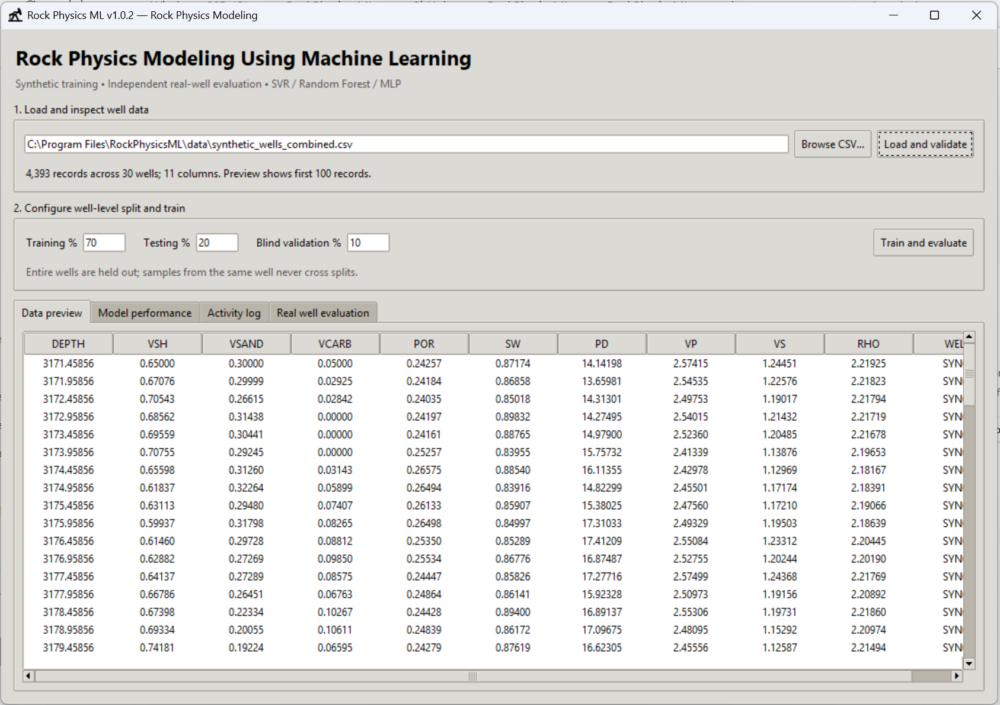

### Synthetic Blind-Validation Results

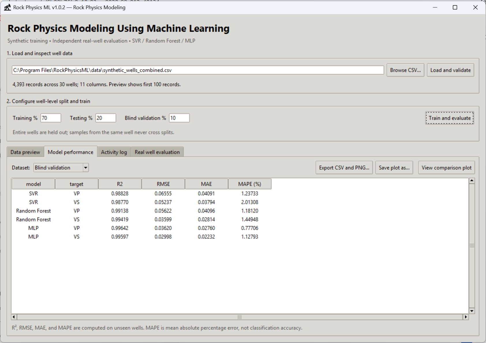

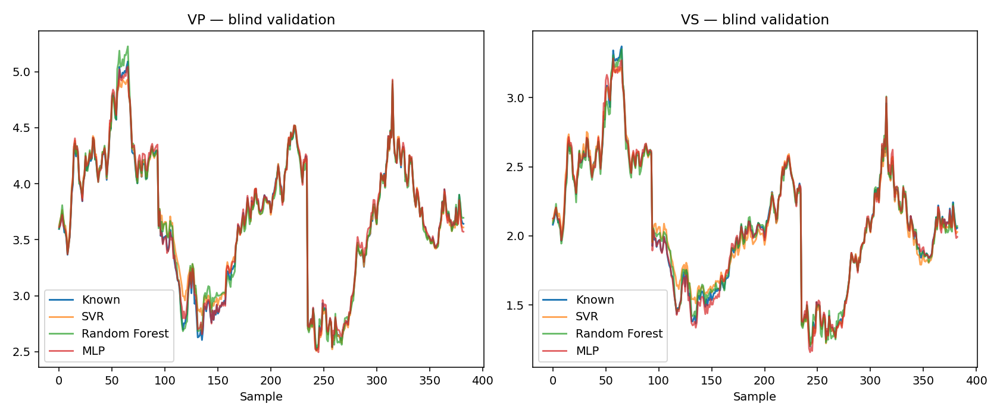

### Independent Real-Well Evaluation

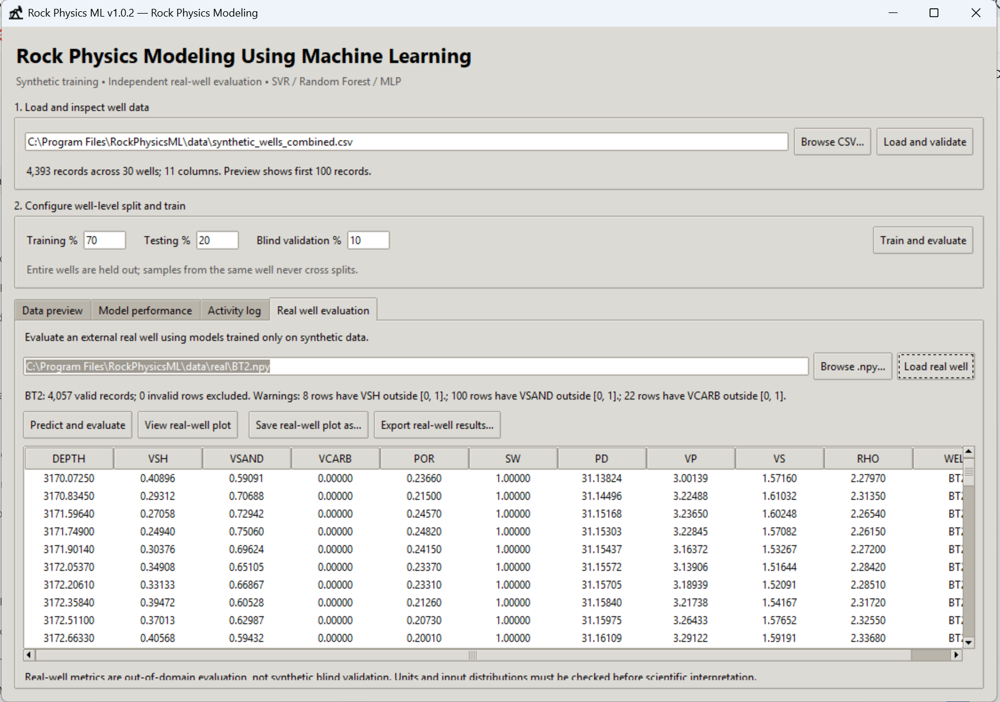

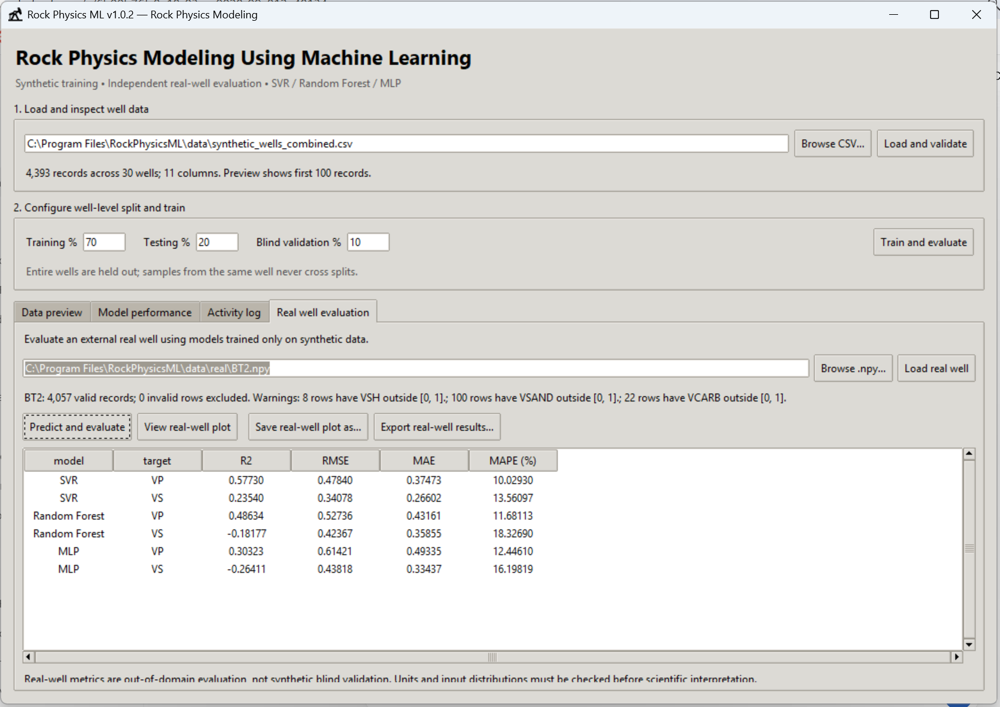

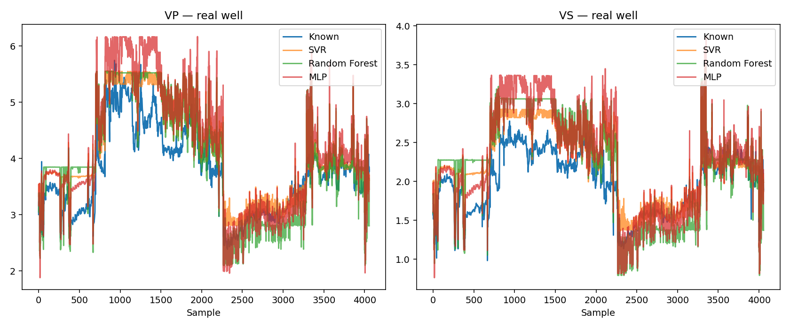

### Windows Installation

The following screenshots demonstrate the installation process for version 1.0.2.

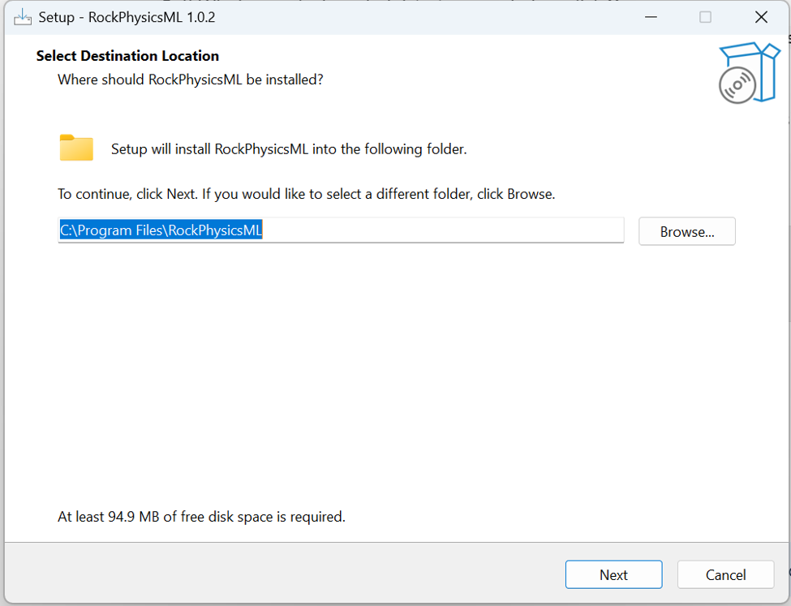

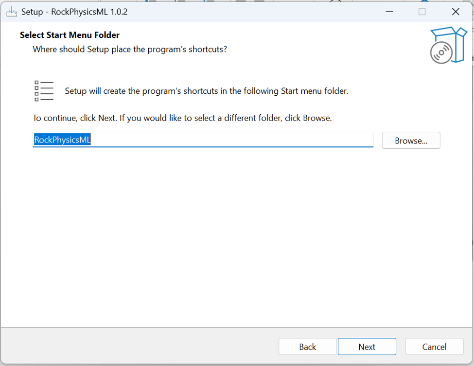

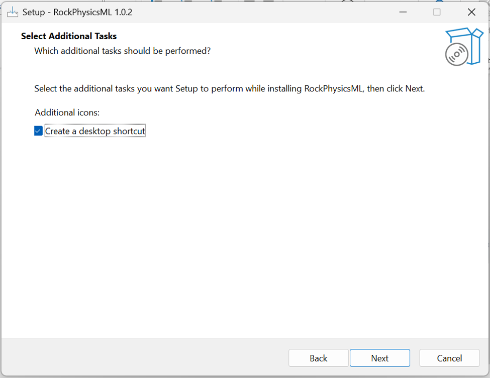

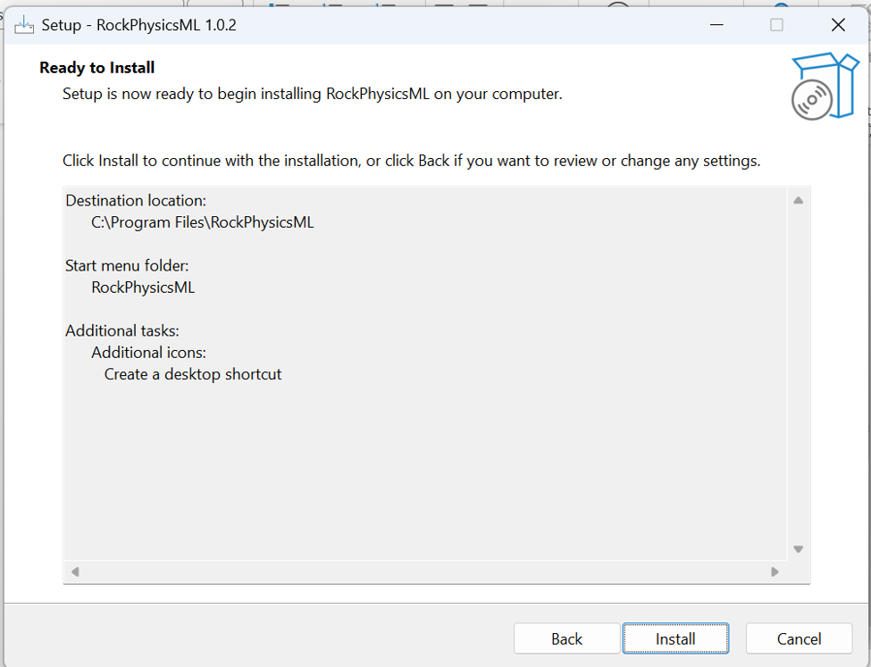

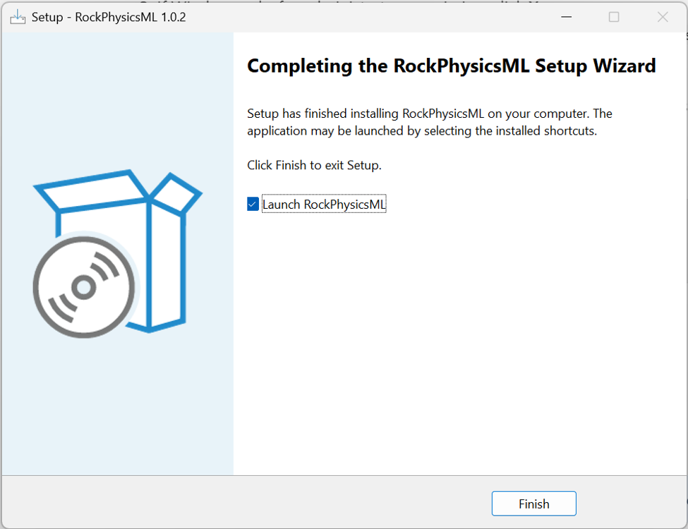


## Dataset

The included synthetic dataset contains 4,393 records across 30 wells and 11 columns.

Real-well datasets are supported through NumPy `.npy` files. These files are not included in the public source repository pending confirmation of redistribution permissions.

## Evaluation Results

### Synthetic Blind Validation

The following results were obtained using a 70% training, 20% testing, and 10% blind-validation configuration.

| Model | VP R² | VS R² |
|---|---:|---:|
| SVR | 0.98828 | 0.98770 |
| Random Forest | 0.99138 | 0.99419 |
| MLP | 0.99642 | 0.99597 |

These results demonstrate strong predictive performance on the synthetic blind-validation dataset.

### Independent Real-Well Evaluation

The application was also evaluated using the BT2 real-well dataset, containing 4,057 valid records.

| Model | VP R² | VS R² |
|---|---:|---:|
| SVR | 0.57730 | 0.23540 |
| Random Forest | 0.48634 | -0.18177 |
| MLP | 0.30323 | -0.26411 |

The difference between synthetic and real-well performance highlights the challenges of model generalization and differences between training and deployment data distributions.

These results should be interpreted as experimental outcomes rather than validated scientific predictions.

## Technologies Used

- Python
- NumPy
- Pandas
- Scikit-learn
- Matplotlib
- Tkinter
- PyInstaller
- Inno Setup
- Windows 11

## Windows Installation

Rock Physics ML v1.0.2 is distributed as a Windows installation package.

The installer:

- Installs the application under `C:\Program Files\RockPhysicsML`
- Creates Start Menu shortcuts
- Optionally creates a desktop shortcut
- Installs the included synthetic dataset
- Provides an uninstall option through Windows

A downloadable installer will be available under the repository's **Releases** section.

## Running from Source

Install Python and the dependencies listed in `requirements.txt`.

```bash
python -m venv .venv
```

Activate the virtual environment and install the dependencies:

```bash
python -m pip install -r requirements.txt
```

Run the application:

```bash
python gui.py
```

See `BUILD_WINDOWS.md` for Windows build and packaging instructions.

## Software Engineering Documentation

The project was developed through multiple stages:

1. Requirements specification
2. Software analysis
3. System and detailed design
4. Implementation
5. Testing and validation
6. Windows packaging and deployment

The final application demonstrates how software engineering practices can be applied to deliver a complete, user-facing software product.

## Author

**Joel R. Serfoss**  
Bachelor of Science in Computer Science  
University of Houston–Downtown

## Version

**1.0.2 — Final Software Engineering Course Project Release**